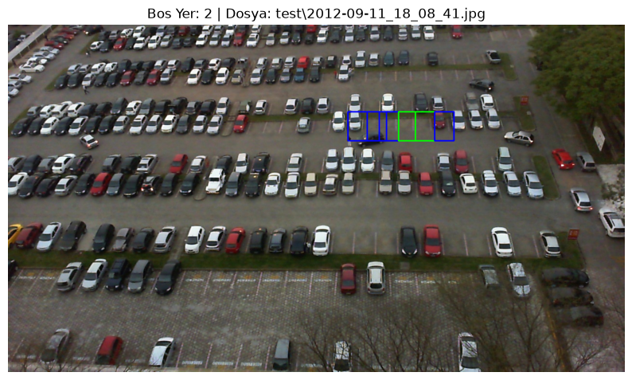

# Otopark Doluluk Tespiti (Parking Space Detection)

## Proje Amacı
Bu proje, dış mekan otoparklarında dinamik ışık değişimleri, keskin bina gölgeleri ve düşük kontrast gibi zorlu çevresel koşullar altında otopark doluluk durumunu tespit etmeyi amaçlayan bir Sayısal Görüntü İşleme (Digital Image Processing) çalışmasıdır.

## Ekip
* Muhammet Furkan Kart 

## Yöntem Özeti
Sistem, belirlenen park alanlarını (ROI - Region of Interest) analiz etmek için şu ardışık düzeni (pipeline) kullanır:
1. **Gri Tonlama & CLAHE:** Karanlık gölgelerdeki detayları ortaya çıkarmak için Adaptif Histogram Eşitleme (CLAHE) uygulanır.
2. **Gürültü Filtreleme:** Gaussian Blur ile ufak pürüzler giderilir.
3. **Yönlü Kenar Tespiti (Sobel X):** Bina gölgelerinin yarattığı yatay çizgileri (yanılgıları) yok etmek ve sadece araçların dikey hatlarını bulmak için X ekseninde Sobel filtresi kullanılır.
4. **Morfolojik İşlemler & Eşikleme:** Bulunan kenarlar genişletilir (dilate) ve ROI içerisindeki beyaz piksel yoğunluğu hesaplanır. Yapılan Ar-Ge testleri sonucunda optimum doluluk eşik değeri **%12** olarak belirlenmiştir.

## Kurulum
Projeyi bilgisayarınızda çalıştırmak için aşağıdaki kütüphanelerin yüklü olması gerekmektedir:
pip install opencv-python numpy matplotlib jupyterlab
## Örnek Çalıştırma Komutu
Proje geliştirme testleri Jupyter Notebook üzerinden yürütülmektedir. Geliştirme ortamını başlatmak için terminale şu komutu yazabilirsiniz:jupyter lab src/otopark_analizi_jupyter.ipynb
## Veri Erişimi
Kullanılan otopark veri seti projenin kök dizinindeki data/ klasöründe yer almaktadır. Veriler geliştirme (42 adet) ve test (18 adet) olarak ikiye ayrılmıştır. Veri setinin çekim koşulları ve detaylı bilgisi için data/README.md dosyasına bakabilirsiniz.
## Bilinen Sınırlamalar
Sistem "Sabit Koordinat Kutuları (ROI)" mantığıyla çalıştığından standart durumlarda %95 kararlılık göstermektedir. Ancak araçların park alanından çıkmak için manevra yaptığı, çapraz durduğu veya park çizgilerini ihlal ettiği durumlarda komşu alanlara piksel taşması olmakta; bu da boş alanların "dolu" zannedilmesine (False Positive) yol açabilmektedir.
## Sonuçlar ve Performans
Test setinde (18 görsel) elde edilen nihai başarı oranı: **%94.4**

**Başarılı Tespit Örneği:**

**Hata Analizi (Manevra Yapan Araç Anomalisi):**
Sistemin yanıldığı tek test fotoğrafı; aracın geri çıkarken yatay pozisyonda kalıp komşu park yerlerinin izleme bölgesini (ROI) fiziksel olarak ihlal ettiği durumdur.
